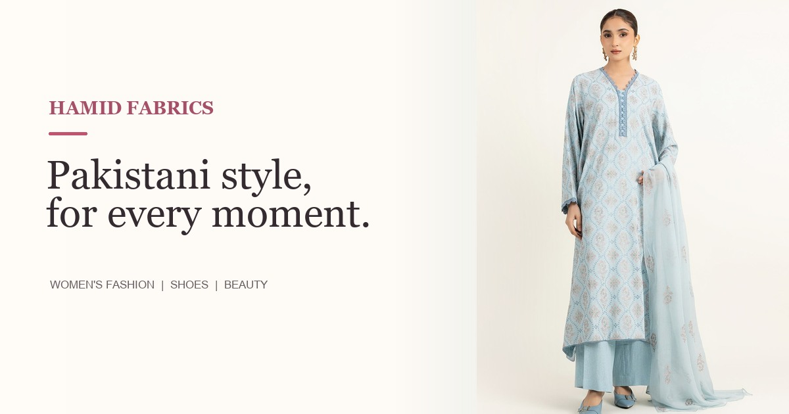

# Hamid Fabrics



**A responsive Pakistani women's fashion storefront.**

[Open the live website](https://hamid-fabrics.vercel.app/)

## Project files

The main website is split into separate files:

- `index.html` — page structure and content
- `style.css` — responsive layout and visual styles
- `script.js` — storefront interactions and catalog behavior
- `images/` — product, collection, and website preview images
- `app.webmanifest` and `sw.js` — installable Progressive Web App support

`hamid-fabrics-single-file.html` is also included as a standalone version. It embeds the page styles and JavaScript and uses the same `images/` folder.

## Run locally

For a quick preview, open `index.html` in a browser. To test service-worker and installable PWA features, serve the folder over localhost, for example:

```powershell
py -m http.server 8000
```

Then open <http://localhost:8000>.

## Storefront features

- Responsive collections and product catalog with search and filters
- Shopping cart, wishlist, product quick view, and comparison
- Mobile navigation drawer and desktop image-led category menus
- Product image transitions on touch screens and hover on desktop
- Fabric and size guides, style notes, and frequently asked questions
- Installable PWA with offline app-shell support

## Preview status

This is a static storefront preview. Product listings, prices, and stock are examples. The site does not process payments, store orders, or verify delivery, returns, exchanges, or inventory. Confirm the real catalog and store policies before using it as a live shop.

Image sources and attribution notes are documented in [README.txt](README.txt).
